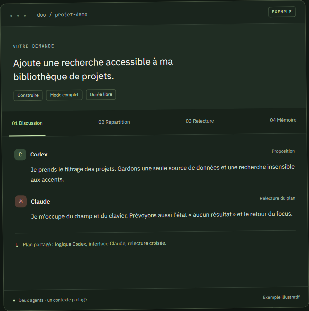

# Duo

**Une demande. Codex et Claude, sur le même projet.**

Duo est une application Windows indépendante. Elle connecte les CLI officiels Codex et Claude Code à vos abonnements existants. Les deux agents proposent une approche, discutent, se répartissent les tâches et relisent les changements du partenaire. Leurs messages et leur activité restent visibles.

[Télécharger](https://github.com/kofudev/duo/releases/latest) · [Guide complet](docs/usage.fr.md) · [English](README.md) · [Contribuer](CONTRIBUTING.md)

_Exemple illustratif du parcours de collaboration présenté sur le site._

## Commencer

1. Télécharger **Duo-Setup-0.4.1.exe**, ou extraire toute l'archive portable. Windows x64 requis. Cette première version publique n'est pas signée.
2. Installer [Codex CLI](https://learn.chatgpt.com/docs/cli) et [Claude Code](https://code.claude.com/docs/en/setup). Connecter vos comptes avec `codex login` et `claude auth login`.
3. Dans Duo, actualiser **Connexions**, choisir un dossier projet et lancer une demande. Le mode **Discuter** permet de commencer en lecture seule.

Vos abonnements doivent inclure l'accès aux CLI. Duo ne débloque aucun modèle absent de votre compte. Git sert aux opérations dépôt ; GitHub CLI reste facultatif. Node.js est nécessaire pour les lanceurs CLI installés via npm.

## Dans cette version

Projets et worktrees, éditeur, diffs, commits sélectionnés, push confirmé, modèles et efforts compatibles, 19 skills sélectionnables, mémoire personnelle commune, notes par projet, durée facultative et planification locale. Le mode économe est activé par défaut ; le mode complet ajoute des tours de discussion.

Les imports mémoire passent par un aperçu : texte, Markdown ou JSON mémoire. Vous choisissez ce qui sera partagé. La récupération utilise des extraits ciblés et bornés, sans relire tout votre historique ni appeler un modèle pour l'import.

## Limites connues

La coordination a été vérifiée avec des CLI de test locaux, jusqu'à la construction et la relecture. Une mission complète avec deux abonnements réels reste à valider. [Détail des vérifications](docs/validation.md).

Les quotas du compte Claude ne sont pas exposés ici. Les budgets locaux et réserves Codex ne peuvent pas garantir de ne jamais atteindre les limites : d'autres applications et l'appel en cours peuvent consommer du quota. La planification nécessite Duo ouvert et Windows éveillé.

La mémoire des applications web ChatGPT et Claude se transfère manuellement, après vérification. Terminal interactif, pièces jointes multimodales, exécution cloud et catalogue général de connecteurs ne sont pas inclus.

## Participer

Consultez [le guide de contribution](CONTRIBUTING.md), [la feuille de route](docs/roadmap.md) ou [les problèmes ouverts](https://github.com/kofudev/duo/issues). Pour lancer le projet : Windows, Node.js 24, `npm ci`, puis `npm start`.

Code Duo sous [licence MIT](LICENSE). Ressources tierces sous leurs licences respectives : [attributions](THIRD_PARTY.md). Application indépendante d'OpenAI et d'Anthropic.
